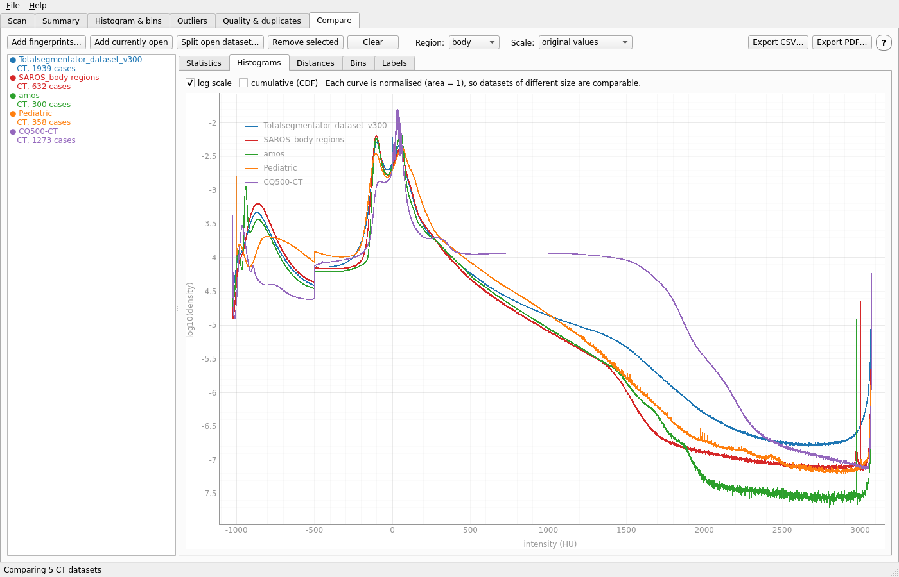
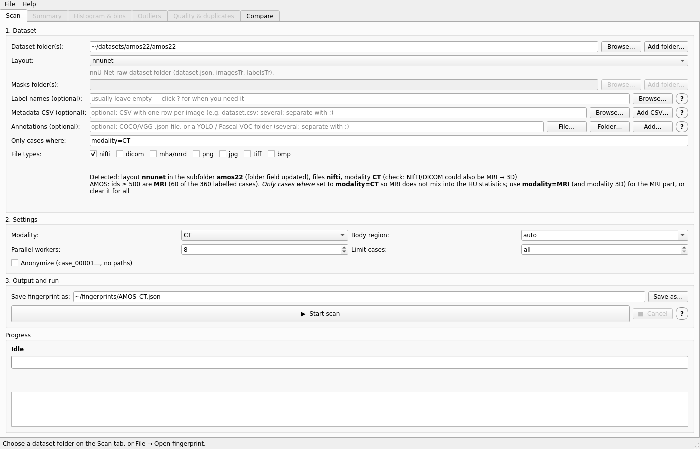
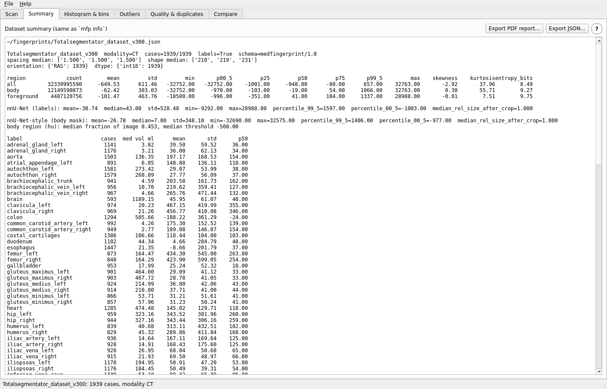
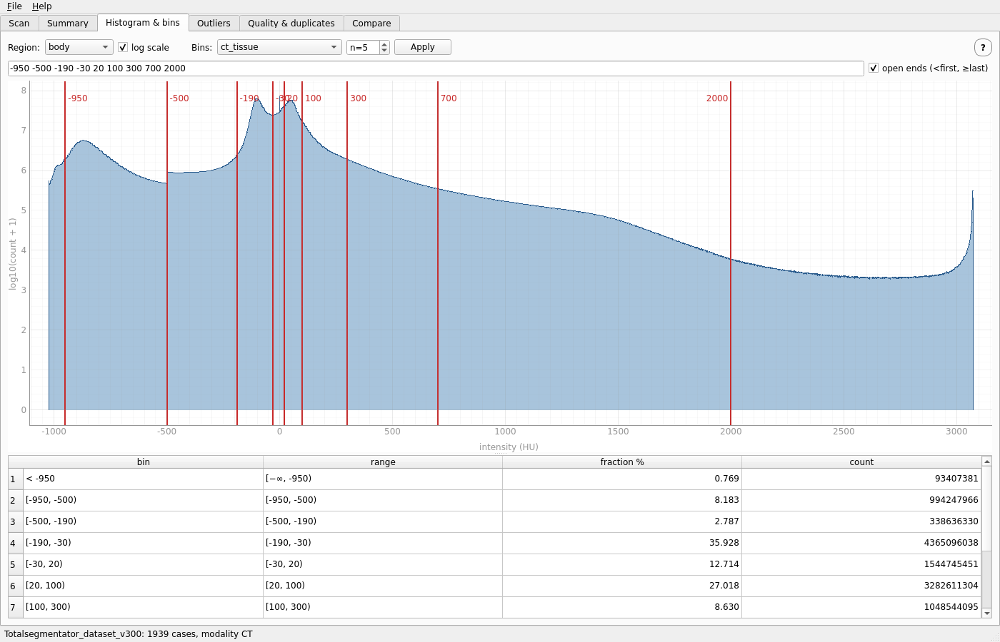
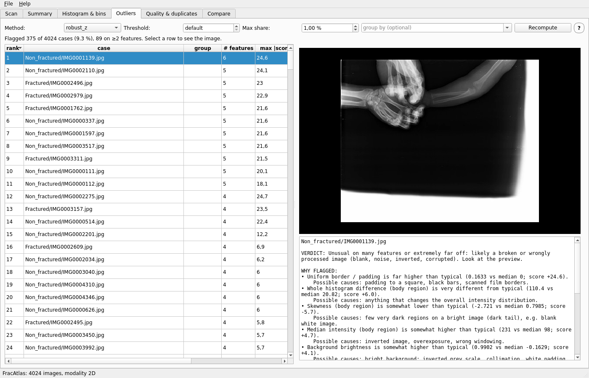
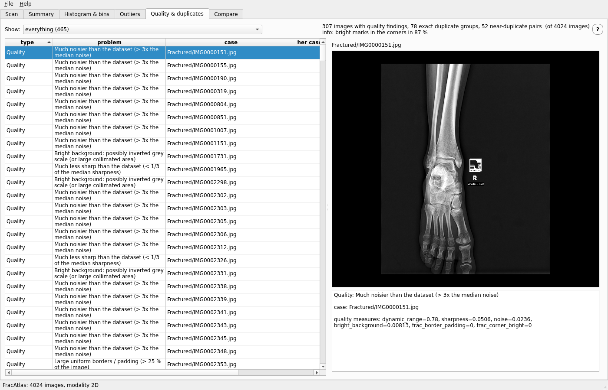
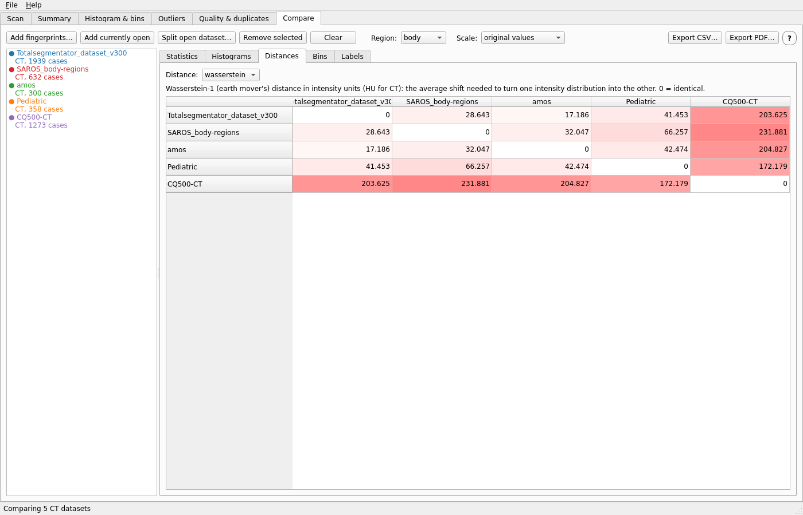
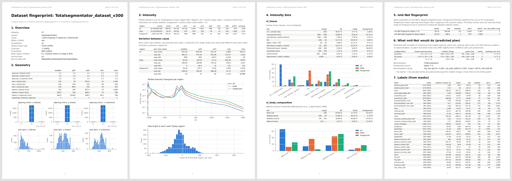

# medfingerprint

[](LICENSE)


**Dataset fingerprinting for medical imaging: CT, X-ray and other 2D/3D images.**

medfingerprint scans an imaging dataset once and summarises it in a *fingerprint*: geometry,
intensity distributions, per-structure label statistics, image quality, duplicates, outliers
and the nnU-Net plan the data would get. It builds on the dataset fingerprint of
[nnU-Net](https://github.com/MIC-DKFZ/nnUNet). Fingerprints can be explored in a desktop
application, exported as PDF reports, split into groups and compared across datasets, so
differences between datasets (scanners, protocols, populations, preprocessing) become visible
before a model is trained.



## Contents

- [Features](#features)
- [Screenshots](#screenshots)
- [Installation](#installation)
- [Quick start](#quick-start)
- [Supported data](#supported-data)
- [Graphical application](#graphical-application)
- [Command line](#command-line)
- [Outputs](#outputs)
- [Development and tests](#development-and-tests)

## Features

- **Statistics:** geometry (spacing, shape, orientation, anisotropy), pooled and per-case
  intensity statistics for the whole image, the body and the labelled foreground, and a fine
  histogram per case so bins and percentiles can be changed later without rescanning.
- **nnU-Net compatible:** `nnunet_fingerprint` has the same fields as nnU-Net v2's
  `dataset_fingerprint.json` (verified identical). A body-mask version covers datasets without
  masks, and the predicted nnU-Net plan (target spacing, patch size, batch size) is included.
- **Labels and annotations:** per-structure presence, volume and HU statistics from label maps,
  binary mask folders (TotalSegmentator), sparsely annotated masks (SAROS) or 2D object
  annotations (COCO, VGG, YOLO, Pascal VOC).
- **Quality checks:** blur, noise, inverted grey scale, padding, saturation, burned-in marks,
  exact and near-duplicate images (including leakage between train / valid / test).
- **Outliers:** robust per-feature scoring, optionally within groups (body part, scanner,
  split), with an explanation of why each case was flagged.
- **Comparison:** overlaid histograms and CDFs, Wasserstein / KS / Jensen-Shannon distance
  matrices, bin fractions and per-label tables for two or more datasets. A fingerprint can be
  split into groups from a metadata column, e.g. abnormal vs normal, without rescanning.
- **Metadata:** metadata CSVs (one or several), DICOM tags, `dataset.json` splits; scan
  only a subset (`--only modality=CT`).
- **Scale and robustness:** parallel, resumable and memory-aware scans. CheXpert's 223,414
  images aggregate in about 2.5 minutes, and an interrupted scan resumes from its cache.
- **Reports:** a PDF report per dataset and a PDF/CSV for comparisons.

## Screenshots

| | |
|---|---|
|  **Scan:** choose a folder; layout, file types, labels and metadata are detected. |  **Summary:** TotalSegmentator v3 (1,939 CT scans, 117 structures). |
|  **Histogram & bins:** pooled body histogram with CT tissue bins; edges can be dragged. |  **Outliers:** ranked cases with a preview and an explanation (FracAtlas). |
|  **Quality & duplicates:** rule-based image problems and duplicates. |  **Compare:** Wasserstein distance between body-HU distributions of five CT datasets. |

PDF report (first four of ten pages, TotalSegmentator v3):



Images shown are from the public FracAtlas, TotalSegmentator, SAROS, AMOS, Pediatric-CT-SEG and
CQ500 datasets (see [Supported data](#supported-data)).

## Installation

Requirements: **Python 3.10 or newer** and about 1 GB of disk space for the dependencies.
Developed and tested on Linux (Ubuntu, Python 3.13). The code is platform independent, but
macOS and Windows have not been tested yet; memory-aware scheduling of parallel workers is
Linux-only (elsewhere, set fewer workers for very large CT volumes).

### 1. Get the code

```bash
git clone https://github.com/fhrzic/medfingerprint.git
cd medfingerprint
```

### 2. Create a virtual environment and install

Linux / macOS:

```bash
python3 -m venv .venv
.venv/bin/pip install --upgrade pip
.venv/bin/pip install -e ".[gui]"          # application + command line
# .venv/bin/pip install -e ".[gui,dev]"    # + test dependencies
```

Windows (PowerShell):

```powershell
py -3 -m venv .venv
.venv\Scripts\pip install --upgrade pip
.venv\Scripts\pip install -e ".[gui]"
```

Without `[gui]` only the command line is installed (no PySide6 / pyqtgraph), which is enough
for servers and batch jobs.

### 3. Check the installation

```bash
.venv/bin/mfp --help            # Windows: .venv\Scripts\mfp --help
.venv/bin/mfp gui               # opens the application
```

Activate the environment (`source .venv/bin/activate`, Windows `.venv\Scripts\activate`) to
type `mfp` directly. On Linux, `./medfingerprint-gui.sh` starts the application and can be
used as a desktop launcher.

### Troubleshooting

- **`qt.qpa.plugin: Could not load the Qt platform plugin "xcb"`** (Linux): install the XCB
  libraries, e.g. `sudo apt install libxcb-cursor0`.
- **Workers crash on huge CT volumes:** use fewer parallel workers. On Linux the scan already
  limits concurrent cases to the available memory and retries crashed cases one at a time.
- **DICOM datasets distributed as `.zip`** (e.g. CQ500) must be unzipped first.

## Quick start

1. `mfp gui`
2. **Scan** tab: *Browse…* to the dataset folder. Check the detected layout, file types and
   modality, then **Start scan**. The fingerprint is saved to `~/fingerprints/<name>.json`.
3. Explore it on the **Summary**, **Histogram & bins**, **Outliers** and
   **Quality & duplicates** tabs; *Export PDF report…* writes a report.
4. **Compare** tab: *Add fingerprints…* to compare datasets.

Saved fingerprints are reopened with *File → Open fingerprint* (Ctrl+O) or `mfp gui fp.json`.
Keep `fp.json` and `fp.arrays.npz` together.

From the command line:

```bash
mfp scan --root /data/FracAtlas/images --ext jpg --modality 2D --out fracatlas.json --limit 100
mfp info fracatlas.json
mfp report fracatlas.json          # -> fracatlas.pdf
```

## Supported data

**Formats:** NIfTI, DICOM (series are grouped automatically), MHA/NRRD, PNG, JPEG, TIFF, BMP.

**Layouts** (detected automatically in the application):

| Layout | Structure |
|---|---|
| `files` | any image files under one or more folders (e.g. `train/`, `valid/`) |
| `paired` | image folder(s) + mask folder(s), matched by file name |
| `nnunet` | nnU-Net v2 raw dataset or Medical Segmentation Decathlon (`dataset.json`, `imagesTr`, `labelsTr`, `imagesVa`…) |
| `totalsegmentator` | `sXXXX/ct.nii.gz` + `segmentations/*.nii.gz` + `meta.csv` |
| `saros` | SAROS DICOM series + sparse NIfTI masks linked by `Segmentation-Info*.csv` |

**Tested on these public datasets:**

| Dataset | Type | Notes |
|---|---|---|
| [TotalSegmentator](https://github.com/wasserth/TotalSegmentator) v2 / v3 | CT, 117 structures | `meta.csv` read automatically |
| [SAROS](https://github.com/UMEssen/saros-dataset) | CT DICOM, body regions / parts | every 5th slice annotated; handled explicitly |
| [AMOS 2022](https://amos22.grand-challenge.org/) | CT + MRI, 15 organs | modality tagged (ids ≥ 500 are MRI) |
| [Pediatric-CT-SEG](https://www.cancerimagingarchive.net/collection/pediatric-ct-seg/) | CT DICOM | TCIA `metadata.csv` |
| [CQ500](http://headctstudy.qure.ai/dataset) | head CT DICOM | unzip first |
| [FracAtlas](https://doi.org/10.6084/m9.figshare.22363012) | X-ray | `dataset.csv` + COCO annotations |
| [MURA](https://stanfordmlgroup.github.io/competitions/mura/) | X-ray | study labels (normal / abnormal) attached |
| [CheXpert](https://stanfordmlgroup.github.io/competitions/chexpert/) (small) | X-ray | `train.csv` + `valid.csv` |
| [GRAZPEDWRI-DX](https://doi.org/10.6084/m9.figshare.14825193) | X-ray | annotations |

The datasets are not included. Download them from their providers and follow their licences.

## Graphical application

```bash
mfp gui                      # or ./medfingerprint-gui.sh
mfp gui fp.json              # open an existing fingerprint
```

* **Scan**: choose the dataset folder. Layout, file types and modality are detected (check them),
  and a metadata CSV (`dataset.csv`, `meta.csv`, …) or COCO annotation file next to the images
  is filled in automatically. Then Start. The progress bar shows cases/s, elapsed and remaining time; failures appear in
  the log. Cancel keeps finished cases, and Start again resumes.
* **Summary**: the same as `mfp info`. *Export PDF report…* (also File menu, Ctrl+P).
* **Histogram & bins**: pick a region, apply quantile / equal-width / CT presets or type edges.
  Drag the red lines to move edges; the table updates live and edges snap to histogram bins.
* **Outliers**: method, threshold, max share and group-by (drop-down with folder levels and
  metadata columns). Select a case to see its previews (axial/coronal/sagittal for 3D), why it
  was flagged and its quality findings.
* **Quality & duplicates**: rule-based image problems, exact and near-duplicates (pairs shown
  side by side) and annotation checks, filterable by type.
* **Compare**: load two or more fingerprint JSONs. Tabs:
  * statistics side by side, with Δ and Δ % for two datasets
  * overlaid normalised histograms or CDFs
  * distance matrix (Wasserstein in HU, KS, Jensen-Shannon)
  * bin fractions, with a bar chart
  * per-label comparison

  *Split open dataset…* makes one fingerprint per group (folder or metadata column, e.g.
  Fractured vs Non_fractured) from the scan cache and adds the groups.
  *Export CSV…* writes all tables to one file, *Export PDF…* a comparison report.
* Help: `?` buttons, the Help menu, and tooltips on controls and feature names.

## Command line

```bash
# TotalSegmentator (<root>/sXXXX/ct.nii.gz + segmentations/*.nii.gz + meta.csv)
mfp scan --layout totalsegmentator --root /data/Totalsegmentator_dataset_v201 \
         --modality CT --out fingerprints/totalseg.json --workers 8

# SAROS (TCIA): DICOM CT series + case_XXX/body-regions.nii.gz masks, linked by
# Segmentation-Info*.csv. Masks are on a 5 mm grid, every 5th slice annotated (255 = not
# annotated): label statistics use the annotated slices only (placed by physical position),
# volumes are estimated by scaling each annotated slice to the stretch it represents.
mfp scan --layout saros --root /data/SAROS --modality CT --saros-mask body-regions \
         --out fingerprints/saros_body-regions.json --workers 8

# nnU-Net raw dataset (imagesTr/labelsTr/dataset.json)
mfp scan --layout nnunet --root $nnUNet_raw/Dataset001_X --modality CT --out fp.json

# Image + mask folders, label names from JSON ({"1": "liver"} or {"liver": 1})
mfp scan --layout paired --images imgs/ --masks masks/ --labels-json labels.json --out fp.json

# Any files under a root (DICOM series are grouped automatically for CT/3D)
mfp scan --layout files --root xrays/ --ext png jpg tiff dicom --modality 2D --out xr.json

mfp info fp.json                                        # summary
mfp bins fp.json --preset ct_tissue --region body       # preset bins
mfp bins fp.json --edges 0 120 180 216 --open-ends      # custom bins (instant, no rescan)
mfp bins fp.json --list
mfp outliers fp.json --method robust_z --top 20         # robust_z | zscore | iqr
mfp outliers fp.json --group-by level:1 --per-feature   # within MURA body parts (train/XR_WRIST/...)
mfp outliers fp.json --group-by meta:institute          # within a metadata column
mfp compare a.json b.json [c.json ...] --csv cmp.csv    # side-by-side table + distance matrices
mfp compare a.json b.json --pdf cmp.pdf                 # comparison PDF
mfp compare a8bit.json b16bit.json --scale robust       # both on a common 0-255 scale
mfp report fp.json [--out fp.pdf]                       # PDF report of one fingerprint
mfp split fp.json                                       # list possible groups
mfp split fp.json --by meta:hand                        # one fingerprint per group (no rescan)

# 2D dataset with a metadata CSV and object annotations (e.g. FracAtlas)
mfp scan --root FracAtlas/images --ext jpg --modality 2D --meta-csv FracAtlas/dataset.csv \
         --annotations "FracAtlas/Annotations/COCO JSON/COCO_fracture_masks.json" --out fracatlas.json
```

Useful flags: `--limit N` (try on N cases first), `--anonymize` (case ids → `case_00001`,
paths dropped, mapping in `<out>.idmap.csv`), `--hist LO HI WIDTH`,
`--body auto|hu|otsu|none|<value>` (see below).
Scans resume from `<out>.cache/` after interruption; unchanged cases are never recomputed.

## Images without masks

Masks are optional. Without them you get everything except label statistics and the
real nnU-Net block. Instead of a label foreground, a **body region** is derived from intensities:

* CT (`--body auto`/`hu`): largest connected component > -500 HU, holes filled per slice.
* Other modalities, or CT that is not in HU (`otsu`): lower threshold of a 3-class Otsu
  (background / soft tissue / dense). Plain 2-class Otsu was rejected because on head CT
  it separates bone from soft tissue.
* A fixed value, e.g. `--body 30`, or `none`.

`nnunet_fingerprint_body` holds nnU-Net-style intensity properties (0.5/99.5 percentiles,
mean, std...) using the body as foreground. It is always computed when a body region exists,
so labelled and unlabelled datasets can be compared on the same footing. It is clearly marked
as **not** nnU-Net's label-based definition (`_foreground_source`).

## Outliers

Each feature is scored per case (robust z by default) and the cases are ranked by how many
features flag them. Rules that came out of testing on TotalSegmentator, CQ500, MURA and CheXpert:

* Fractions such as `frac_at_image_max` (saturation) are zero-inflated. They are scored on a
  log10 scale and only high values are flagged.
* When over half the cases share one value (e.g. images resized to 512 px), the MAD is 0. If
  the other cases form a real minority group (≥10 cases and ≥10 %), the MAD of that group is
  used. Otherwise the mean absolute deviation is used. Spreads below 0.1 % of the median are
  treated as float noise (spacing 1.5 vs 1.5000001).
* `--max-frac 0.01` (default): a case is flagged on a feature only if it is past the
  threshold *and* among the most extreme 1 % in that direction (minimum 5 cases). Without
  this, heavy tails in datasets of 10⁵ images flag tens of thousands of cases. `--max-frac 0`
  turns the cap off; `over_threshold` in `--per-feature` shows the uncapped counts.
* `--group-by level:N | meta:KEY` scores each case against its own group (body part, scanner,
  institute). Groups with fewer than 10 cases use the whole dataset.

## Robustness notes

* NIfTI files whose direction cosines are orthonormal only to ~1e-4 are rejected by ITK
  (14 of 80 checked TotalSegmentator v3 cases). They are re-read in ITK's permissive mode;
  the voxel data is identical to nibabel's, and the case gets a note.
* Hidden files and folders are skipped, including macOS `._name.png` AppleDouble forks
  (found in CheXpert and MURA).
* Each DICOM series is a separate case. CQ500 studies hold thin and thick reconstructions of
  the same scan, so pick one series per study if patients must not be counted twice.

## Metadata CSV, annotations, 2D masks

* `--meta-csv`: one row per image. The id column is detected (file name, stem, relative
  path or a parent folder name); columns become metadata for grouping, splitting and checks.
  Several CSVs are allowed (`--meta-csv train.csv valid.csv`, GUI: "Add CSV…" or `;`), e.g. one
  per dataset folder; each is matched on its own.
* `--only` (GUI: "Only cases where"): scan only cases whose metadata matches, e.g.
  `modality=CT`, `split=train,validation`, `modality!=MRI; split=train`. AMOS cases are tagged
  `modality` CT/MRI (ids ≥ 500 are MRI); the GUI pre-fills `modality=CT` for AMOS.
* `--annotations`: COCO or VGG `.json`, or a YOLO (`.txt`) / Pascal VOC (`.xml`) folder.
  Objects are rasterised into a label map (per-category label statistics and the nnU-Net
  fingerprint work unchanged) and measured one by one: area (px, mm², share of image), box
  size and aspect, polygon points, contrast against a surrounding ring, position heatmap.
  Checks: degenerate/tiny/duplicated objects, objects outside the image, annotated size ≠
  image size, annotated images that do not exist, metadata count columns (e.g.
  `fracture_count`) ≠ number of objects, unusual object sizes/shapes. Images missing from
  the annotation file count as having no objects.
* 2D masks (`--layout paired`): PNG/TIFF label maps; 0/255 masks, grey masks stored as RGB and
  colour-coded label maps are handled; mask files may end in `_mask`, `_seg`, `_label`, `_gt`.

* Several folders as one dataset (e.g. a download already split into train / valid / test):
  give the parent folder, or several folders (`--root train valid test`, `--images` /
  `--masks` one per split, `--annotations` one file or folder per split; in the GUI
  *Add folder…* or `;`-separated). Same file names in different splits are matched to the
  annotation or mask of their own split. Case ids start with the split name, so `level:0`
  groups, splits and compares by split, and copies between splits are flagged as leakage.
  The GUI recognises `<split>/images` + `<split>/masks`, `<split>/labels` (YOLO) and
  `<split>/_annotations.coco.json` (Roboflow) and fills in the fields.

```bash
mfp scan --root ds/train ds/valid ds/test --ext png --modality 2D \
         --annotations ds/train/_annotations.coco.json ds/valid/_annotations.coco.json \
                       ds/test/_annotations.coco.json --out ds.json
mfp scan --layout paired --images ds/train/images ds/test/images \
         --masks ds/train/masks ds/test/masks --ext png --modality 2D --out ds.json
```

## Quality, duplicates, predicted nnU-Net plan

* Per image: sharpness, noise (Immerkaer), bright background (inverted grey scale), uniform
  borders/padding, colour, bright corner marks (burned-in text; informational, not counted as a
  problem), dynamic range. Rule-based problems are listed in `quality.problems`; sharpness and noise are also outlier features.
  CT sharpness/noise are in HU.
* Duplicates: exact (identical pixels) and near-duplicates: 256-bit difference hashes differing
  in at most 5.5 % of their bits (14 bits), found exhaustively by multi-index hashing on 16-bit
  pieces. Calibrated on CheXpert: re-saved/resized copies differ in <= 6 bits, +10 % brightness
  in <= 12, different chest X-rays (closest 1 in 10^5 pairs) in 32. Pairs across top-level
  folders (train/valid, Fractured/Non_fractured) are marked as possible leakage. CheXpert train
  (223k images): 48 s, 0.4 GB; 22 exact groups and 50 near pairs.
* Large datasets: CheXpert train (223,414 images) aggregates in about 2.5 min with a 7.5 GB
  peak; the fingerprint JSON stores one compact line per case.
* `nnunet_plan`: target spacing (incl. the anisotropy rule), median shape, patch size, batch
  size, poolings, 3d_lowres and normalisation following nnU-Net v2's default planner. The
  memory model is simplified; on MSD Hippocampus, Liver and Heart the patch sizes equal
  nnU-Net's.

## Outputs

* `fp.json`: dataset fingerprint (schema `medfingerprint/1.0`)
  * `nnunet_fingerprint`: same fields and semantics as nnU-Net's `dataset_fingerprint.json`
    (verified identical; see note below)
  * `geometry`: spacing, shape, extent, anisotropy, orientation, dtype distributions
  * `intensity.{all,body,foreground}`: pooled exact moments (mean/std/skewness/kurtosis),
    percentiles, entropy, out-of-range fractions, per-case distributions, fine histogram
  * `labels`: per structure: presence, volume, fraction of foreground, intensity (HU) stats
  * `bins`, `outliers`, `flags` (not-HU suspicion, padding values, saturation), `metadata`
    (DICOM technical tags / TotalSegmentator `meta.csv` / `--meta-csv`), `cases` (per-case features)
  * `annotations`, `quality`, `duplicates`, `nnunet_plan` (see above)
  * `local`: paths and cache locations. **Remove it before sharing a fingerprint**
    (`--anonymize` omits it and replaces case ids).
* `fp.arrays.npz`: per-case fine histograms and per-label dataset histograms.

## Design notes

* Every case gets a fixed fine histogram (CT: 1-HU bins over [-1024, 3072) plus
  under/overflow), so bins, percentiles and distances can all be recomputed from the
  fingerprint without re-reading images. Percentiles are exact for integer CT.
* If CT is selected but the data is not in HU (e.g. normalised to [0, 1]), the scan warns,
  switches to an automatic range and uses the Otsu body mask instead of the HU one.
* nnU-Net `mean`/`std` are float32 accumulations, so they differ between NumPy versions at
  the ~1e-6 relative level. Identical samples give 315.56064 on NumPy 2.2.3 and 315.56046 on
  2.5.4. All other nnU-Net fields match exactly.
* Bin presets: `medfingerprint/presets/ct_bins.yaml` (approximate textbook ranges, verify
  before citing). Windows: `ct_windows.yaml`.

## Development and tests

```bash
.venv/bin/python -m pytest tests -q        # ~1-2 min
NNUNET_PY=/path/to/nnunet-env/bin/python .venv/bin/python -m pytest tests -q   # + live check against nnU-Net v2
.venv/bin/python tests/make_synthetic.py OUT_DIR   # synthetic CT / TotalSegmentator / X-ray data
.venv/bin/python tests/make_fracatlas_like.py OUT_DIR   # FracAtlas-like 2D data with planted problems
```

## Citation

If you use medfingerprint in your research, please cite:

```bibtex
@misc{medfingerprint,
  title  = {medfingerprint: dataset fingerprinting for medical imaging},
  author = {Hržić, Franko},
  year   = {2026},
  url    = {https://github.com/fhrzic/medfingerprint}
}
```

Please also cite [nnU-Net](https://doi.org/10.1038/s41592-020-01008-z) (Isensee et al.,
Nature Methods 2021), whose dataset fingerprint this work extends, and the datasets you analyse.

## Funding
The medfinerprint tool is funded by the European Union-NextGenerationEU-SEG-CT-uniri-mz-25-17 (PU-124).

## License

[MIT](LICENSE) © 2026 Franko Hržić. The datasets analysed with medfingerprint keep their own licences.

